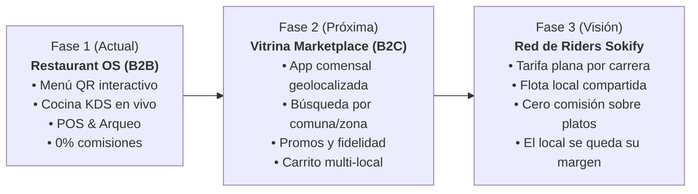

# 🚀 Visión Estratégica Sokify: De Restaurant OS a Marketplace y Red Propia de Reparto (Riders)

> **Documento de Memoria Estratégica · UNIVERSO693 SpA**  
> Fecha: Noviembre 2026  
> Referencia de mercado: `ola.click/es/chile`

---

## 1. La Gran Oportunidad Frente a OlaClick
Actualmente, **OlaClick** en `ola.click/es/chile` se limita a un **directorio estático por país** que simplemente enlaza a las cartas de los restaurantes. No genera una experiencia unificada de compra, no geolocaliza con inteligencia, ni resuelve el problema logístico del despacho.

Por otro lado, aplicaciones como **Uber Eats, PedidosYa y Rappi** cobran comisiones asfixiantes del **25% al 35%** sobre cada plato vendido, confiscando la base de datos de los comensales.

**La Oportunidad de Sokify:**  
Avanzar en 3 fases progresivas para convertirnos en la alternativa soberana, rentable y justa para el ecosistema gastronómico en Chile.

---

## 2. Las 3 Fases de Evolución

### 📍 Fase 1: Masa Crítica de Locales (Etapa Actual)
* **Objetivo:** Lograr que cientos de restaurantes en Viña del Mar, Valparaíso, Santiago y regiones adopten Sokify como su sistema operativo diario.
* **Gancho:** 3 meses 100% gratis, $15.900/mes o $69.000/año (frente a los $150.000+ de OlaClick o Toteat).
* **Resultado:** Ya tenemos los menús digitalizados, los horarios, el stock y los precios en vivo en nuestra base de datos en tiempo real.

---

### 🛍️ Fase 2: La Vitrina / Super-App de Venta Gastronómica (Marketplace Sokify)
* **¿Qué es?:** Una vitrina interactiva web y app móvil donde los comensales buscan qué comer:
  * *"Sushi en Viña del Mar"* o *"Pizzas masa madre cerca de mí"*.
  * Filtros por cercanía GPS, valoraciones de 5 estrellas de Google Maps, promociones del día y métodos de pago (Webpay / Transferencia / Efectivo).
* **Diferencia con Uber/PedidosYa:**
  * **Cero comisión abusiva sobre la comida:** El restaurante no tiene que inflar sus precios un 30% en nuestra app. Los platos valen lo mismo que en el local físico.
  * **Fidelización directa:** El cliente es del restaurante, no de un intermediario.

---

### 🛵 Fase 3: Flota de Riders Sokify (Logística de Última Milla Justa)
* **El dolor del restaurante:** Muchos locales quieren hacer delivery pero no tienen repartidores propios contratados.
* **La Solución Sokify Riders:**
  1. **Red de Repartidores Locales Conectados:**
     * Flota de riders verificados operando con la app de despacho Sokify Driver.
  2. **Modelo de Tarifa Plana por Despacho (Flat Fee):**
     * En lugar de cobrar el 30% de la venta, se cobra solo el **costo del flete logístico real** (ej. $1.990 - $2.500 CLP por carrera según radio de kilómetros).
     * El restaurante cobra sus platos al 100% neto.
  3. **Despacho Compartido por Zona Gastronómica:**
     * Un rider puede recoger pedidos de 2 o 3 locales vecinos en un polo gastronómico (ej. Av. San Martín en Viña, Barrio Italia en Santiago) optimizando rutas.

---

## 3. Ventaja Defensiva Inexpugnable
Cuando un restaurante tiene su carta, su pantalla de cocina (KDS), su punto de venta y su logística de despacho resuelta en **Sokify**, la tasa de cancelación (churn) es prácticamente **cero**.
